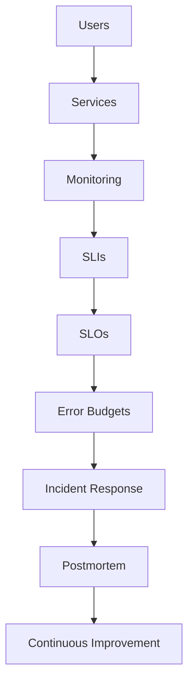
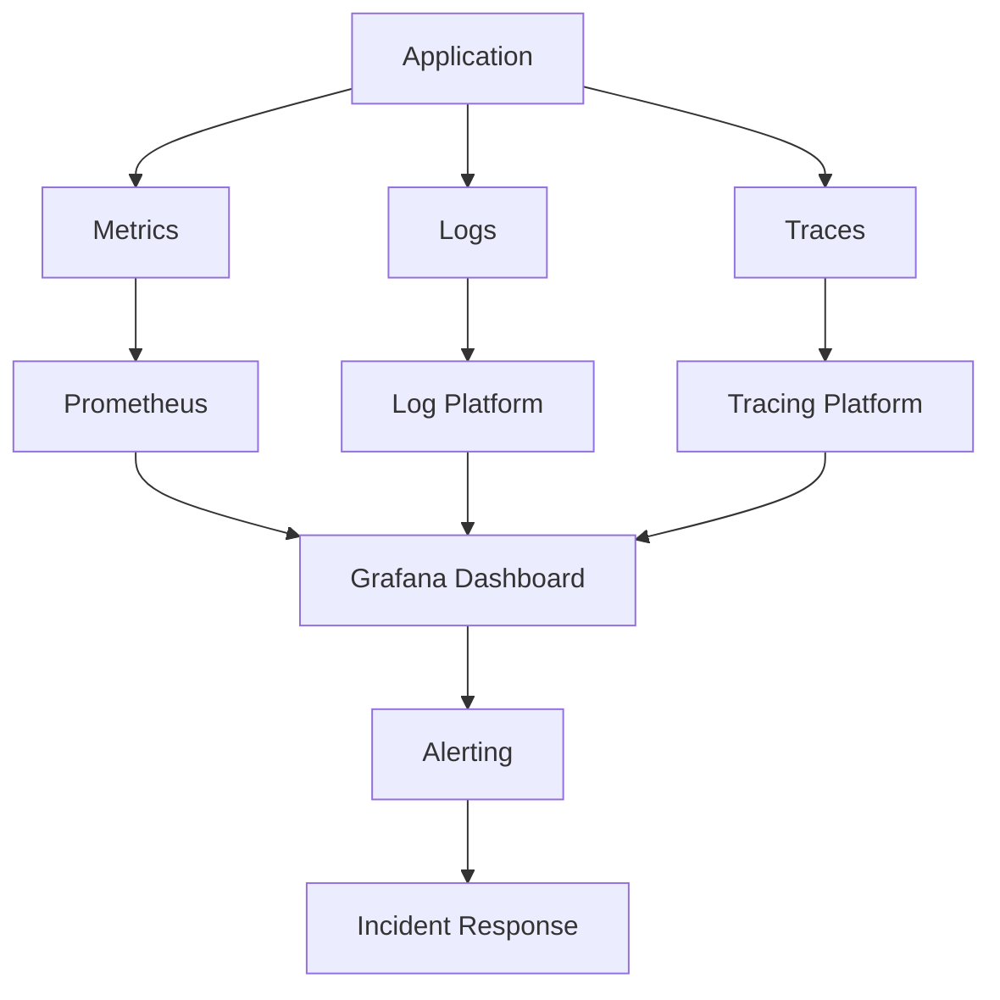

# Platform Reliability Lab

Platform Reliability Engineering and SRE knowledge repository.

---

## Reliability Lifecycle

---

## Observability Model

---

## Contents

### Reliability Foundations

- Service Level Indicators (SLIs)
- Service Level Objectives (SLOs)
- Error Budgets

### Incident Response

- Incident Management
- Postmortems

### Operational Readiness

- Production Readiness Reviews

---

## Focus Areas

- Site Reliability Engineering (SRE)
- Reliability Engineering
- Observability
- Monitoring and Alerting
- Incident Response
- Production Operations
- Service Reliability

---

## Navigation

| Topic | Link |
|--------|--------|
| Service Level Indicators | slis.md |
| Service Level Objectives | slos.md |
| Error Budgets | error-budgets.md |
| Incident Management | incident-management.md |
| Postmortems | postmortems.md |
| Production Readiness | production-readiness.md |
