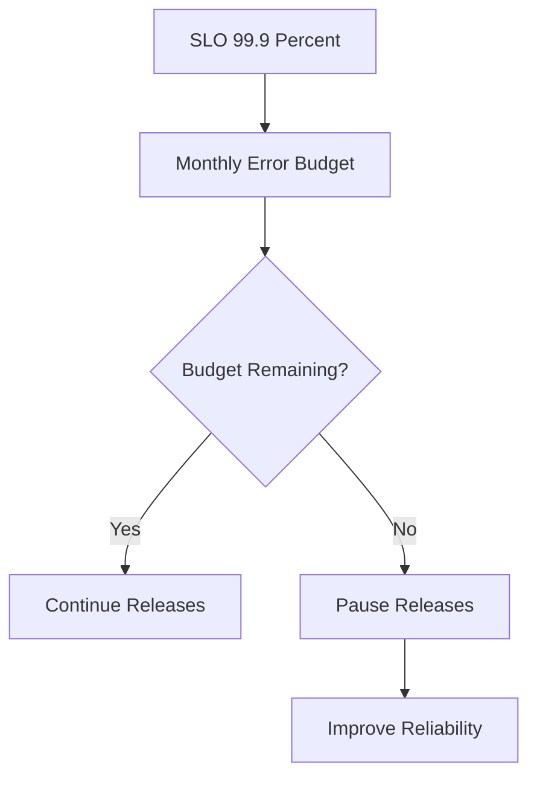

# Error Budgets

## Definition

Error budgets allow controlled failure within a service.

### Example

```text
SLO = 99.9%

Allowed Downtime Monthly:

43.8 minutes
```

---

## Error Budget Flow



---

## Usage

Error budgets guide:

- Release decisions
- Risk management
- Operational priorities

---

## When Budget Is Exhausted

- Pause releases
- Reduce operational risk
- Improve reliability

---

## Navigation

| Previous | Home | Next |
|-----------|------|------|
| slos.md | index.md | incident-management.md |
