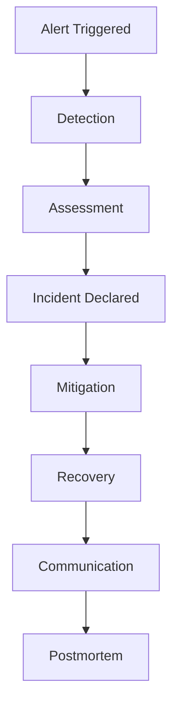

# Incident Management

## Severity Levels

### SEV-1

Critical outage affecting a large number of users or a business-critical service.

### SEV-2

Major degradation affecting significant functionality with available workarounds.

### SEV-3

Minor impact with limited customer disruption.

### SEV-4

Informational issue requiring investigation but not impacting service availability.

---

## Incident Management Workflow

---

## Workflow Stages

### Detection

Issues are identified through monitoring, alerting, customer reports,
or operational teams.

### Assessment

Evaluate impact, affected systems, customer impact,
and incident severity.

### Incident Declaration

Assign severity level and activate the response process.

### Mitigation

Implement actions to reduce business or customer impact.

### Recovery

Restore normal service operation.

### Communication

Provide status updates to stakeholders and affected teams.

### Postmortem

Perform root cause analysis and define corrective actions.

---

## Best Practices

- Define clear severity levels
- Maintain incident runbooks
- Use automated monitoring and alerting
- Establish escalation procedures
- Conduct blameless postmortems
- Track corrective actions

---

## Navigation

| Previous | Home | Next |
|-----------|------|------|
| error-budgets.md | index.md | postmortems.md |
