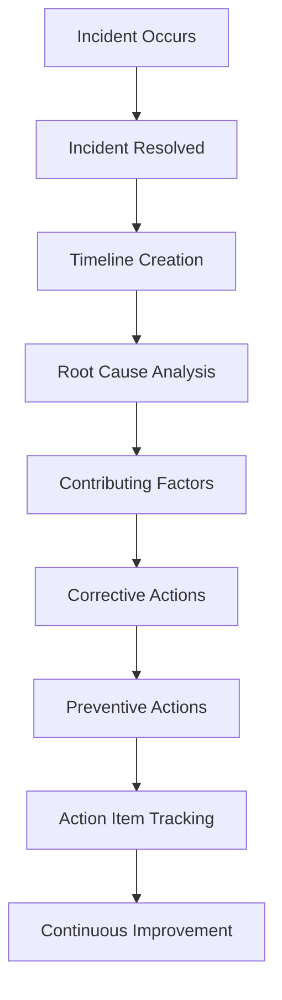

# Postmortems

## Goal

Learn from failures without assigning blame and use incidents as learning opportunities to improve platform reliability.

---

## Postmortem Workflow

---

## Components

### Timeline

Document the sequence of events leading up to the incident.

### Impact

Describe customer impact, business impact, and affected systems.

### Root Cause

Identify the primary technical or operational cause.

### Contributing Factors

Identify additional conditions that helped create the incident.

### Corrective Actions

Actions that resolve the immediate problem.

### Preventive Actions

Long-term improvements designed to prevent recurrence.

---

## Principles

### Blameless

Focus on systems and processes, not individuals.

### Actionable

Every postmortem should produce measurable improvements.

### Measurable

Track completion of follow-up actions.

### Transparent

Share lessons learned across teams.

---

## Example Outcomes

- Improved monitoring
- Better alert thresholds
- Enhanced runbooks
- Additional automated tests
- Increased system resilience

---

## Navigation

| Previous | Home | Next |
|-----------|------|------|
| incident-management.md | index.md | production-readiness.md |
