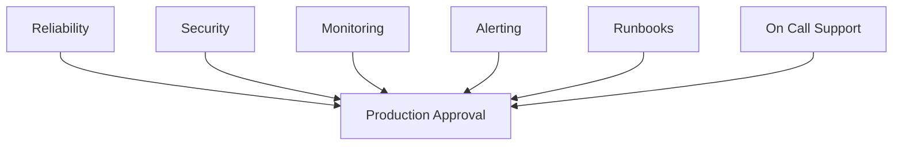

# Production Readiness Review

## Purpose

A Production Readiness Review (PRR) verifies that a service is prepared
to operate safely, reliably, and securely in a production environment.

---

## Production Readiness Workflow

---

## Reliability

Before production deployment:

- SLOs defined
- SLIs measured
- Error budgets established
- Capacity planning completed
- Load testing completed

---

## Observability

The service must provide:

- Metrics
- Dashboards
- Alerts
- Logs
- Traces

Teams should be able to identify issues quickly using observability tooling.

---

## Security

The service should implement:

- Authentication
- Authorization
- Encryption
- Secrets Management
- Vulnerability Scanning

---

## Operations

Operational readiness should include:

- Runbooks documented
- Escalation process defined
- On-call support available
- Incident response procedures documented
- Postmortem process established

---

## Production Readiness Checklist

| Area | Status |
|--------|--------|
| Reliability | ✅ |
| Security | ✅ |
| Monitoring | ✅ |
| Alerting | ✅ |
| Runbooks | ✅ |
| On-Call Support | ✅ |

---

## Benefits

Production readiness reviews help:

- Reduce operational risk
- Improve reliability
- Prevent service outages
- Improve incident response
- Increase deployment confidence

---

## Navigation

| Previous | Home |
|-----------|------|
| postmortems.md | index.md |
