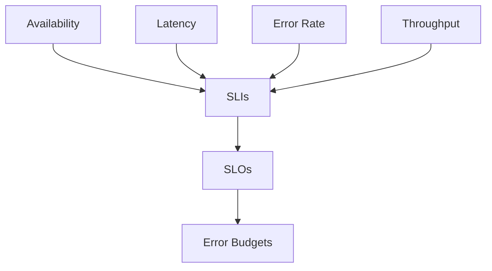

# Service Level Objectives (SLOs)

## Definition

Service Level Objectives (SLOs) define the target level of reliability that a service is expected to achieve.

SLOs are based on Service Level Indicators (SLIs) and help teams measure service performance against customer expectations.

---

## SLI to SLO Model



---

## Example Web API

### Availability

```text
99.95%
```

### Latency

```text
95% of requests under 300ms
```

### Error Rate

```text
Less than 0.1%
```

---

## Why SLOs Matter

SLOs help teams:

- Define reliability targets
- Align technology with business expectations
- Measure customer experience
- Improve platform health
- Support release decisions
- Manage error budgets

---

## Example SLO Dashboard

| Indicator | Target |
|------------|----------|
| Availability | 99.95% |
| Latency (p95) | < 300ms |
| Error Rate | < 0.1% |
| Throughput | Defined per service |

---

## Relationship Between SLI and SLO

| SLI | SLO |
|------|------|
| Availability | 99.95% |
| Latency | p95 < 300ms |
| Error Rate | < 0.1% |
| Throughput | Service-specific target |

---

## Navigation

| Previous | Home | Next |
|-----------|------|------|
| slis.md | index.md | error-budgets.md |
